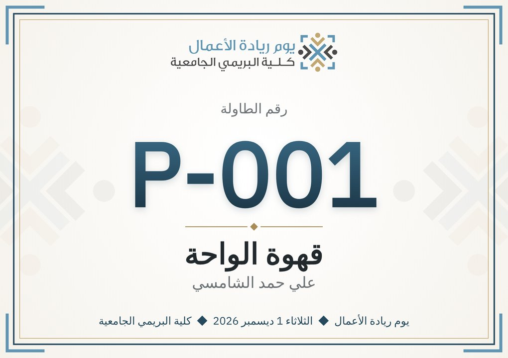

<div dir="rtl">

# منصة تسجيل «يوم ريادة الأعمال» – كلية البريمي الجامعية

منصة تسجيل للمشاريع الطلابية المشاركة في يوم ريادة الأعمال (الثلاثاء 1 ديسمبر 2026). تستقبل الطلبات وتحفظها في Google Sheets، وتعطي كل مشارك رقم طاولة وبطاقة جاهزة للتحميل والطباعة.

**الموقع:** https://mohamad-albadi.github.io/ryada/

<p align="center">
  
  
</p>

## المميزات

- **تسجيل المشاريع على خطوتين:** الاسم والهاتف والرقم الجامعي واسم المشروع، ثم نوع المشاركة والنبذة وإنستغرام والطاولة.
- **ترقيم تلقائي متسلسل:** `P-001`، `P-002`… بدون تكرار حتى لو سجّل أكثر من شخص في نفس اللحظة (LockService).
- **تصنيف VIP تلقائي:** الرقم الجامعي يحدد إذا المشارك من كبار الشخصيات، ويأخذ رقم `VIP-01`… وبطاقة ذهبية خاصة.
- **بطاقة طاولة فاخرة:** ترسم داخل المتصفح (Canvas بدقة 1700×1200) وتنزل صورة PNG مباشرة بعد التسجيل.
- **صفحة طباعة محمية بمفتاح:** تعرض كل البطاقات بطاقتين في كل صفحة A4.
- **إشعار بالإيميل** مع كل تسجيل جديد، و**حماية من التكرار والسبام:** يمنع تكرار الرقم الجامعي، وفيه honeypot وفحص زمن التعبئة.
- **عربي بالكامل (RTL)** ويشتغل على الجوال.

## البنية

```
GitHub Pages (index.html)  ──POST JSON──►  Google Apps Script (backend/Code.gs)
                                                 ├─ Google Sheets  (التسجيلات)
                                                 └─ Gmail          (الإشعارات)
```

| الملف | الوصف |
|---|---|
| `index.html` | الواجهة كاملة في ملف واحد: HTML وCSS وJS، ورسم البطاقات |
| `backend/Code.gs` | الـAPI: التحقق والترقيم والحفظ والإشعارات وصفحة الطباعة |

## التشغيل

1. أنشئ Google Sheet، وانسخ `backend/Code.gs` إلى مشروع Apps Script.
2. عبّئ `SHEET_ID` و`PRINT_KEY` و`VIP_IDS`، ثم شغّل `setup()` مرة واحدة.
3. انشر المشروع **Web app** (Execute as: Me، Access: Anyone).
4. ضع رابط النشر في `API_URL` داخل `index.html`، وفعّل GitHub Pages.

## التقنيات

HTML · CSS · JavaScript (Canvas API) · Google Apps Script · Google Sheets · GitHub Pages

---

تصميم وتطوير: **محمد أحمد البادي**

</div>
